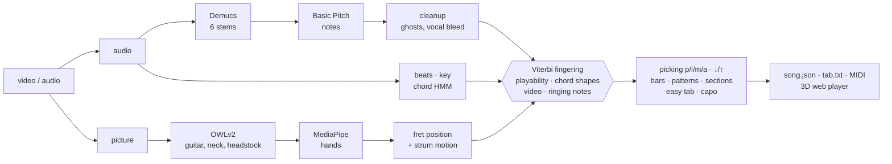

<div align="center">

# ◆ Guitar Reverser

**Turn a guitar video or song into a tab a beginner can actually play.**
Chords, string & fret for every note, fretting fingers, p/i/m/a picking or ↓/↑ strums,
replayed on a 3D fretboard synced to the original recording.


[How it works](#how-it-works) · [Quick start](#quick-start) · [The player](#the-player) · [Accuracy](#accuracy-measured-on-guitarset) · [Roadmap](#roadmap)

</div>

---

## Why

Audio-to-MIDI tools tell you *which* notes are played. A guitarist needs to know *where*:
the same E4 can be played in five places on the neck. They also need to know *how*:
which finger frets it, and whether it's strummed or plucked with the thumb. A beginner wants
the chord shapes and a strum pattern before the full transcription.

Guitar Reverser chains open-source models (stem separation, note transcription, object
detection, hand tracking) with guitar-specific music logic, and ends in a practice player.

| Problem | Usual tools | Guitar Reverser |
|---|---|---|
| Same note, up to 5 places on the neck | guess from audio | **global Viterbi fingering**: stretch, hand shifts (worse when fast), ringing notes, **open-chord shapes** (the classic 16-chord beginner chart is built in), plus a **video prior** from the fretting hand |
| Voice and other instruments | transcribe everything | **Demucs 6-stem separation**, then a vocal-bleed filter drops notes that copy the sung melody |
| Ghost notes and harmonics | kept | octave-ghost filter, plus a **robust decoder** that may drop a quiet note rather than force an impossible jump |
| Picking hand | ignored | **p/i/m/a** for fingerstyle; **↓/↑** from string onset order, wrist motion in the video, or "down on the beat" |
| Beginners | one dense tab | three levels: **Chords** (shapes + strum), **Easy tab** (bass + melody on the shapes), **Full tab** |
| Tuning off A440 | split notes | estimates the offset and cancels it by resampling before transcription |

## How it works



| Stage | Brick | What this project adds |
|---|---|---|
| Stems | [Demucs](https://github.com/facebookresearch/demucs) `htdemucs_6s` | guitar = guitar + bass + ½ other (acoustic low strings leak into "bass") |
| Notes | [Basic Pitch](https://github.com/spotify/basic-pitch) | tuning correction, merging, octave-ghost and vocal-bleed filters |
| Rhythm | [librosa](https://librosa.org) beat tracker | meter and downbeat from chord changes and bass onsets |
| Chords | — | beat-synchronous chroma from the note posteriorgram, bass weighting, two-pass key prior, "no chord" state, Viterbi |
| Guitar in the picture | [OWLv2](https://huggingface.co/google/owlv2-base-patch16-ensemble) (open-vocabulary detection) | neck axis from body → fretting hand, nut from an aligned headstock |
| Hands | [MediaPipe Hand Landmarker](https://ai.google.dev/edge/mediapipe/solutions/vision/hand_landmarker) | fret from geometry (`−12·log2(1 − d/scale)`), picking-hand velocity |
| Fingering | — | Viterbi over hand states with drop states for ghost notes, then fretting fingers and picking fingers |
| Player | [three.js](https://threejs.org), Vite, TypeScript | everything in `web/` |

## Quick start

Needs Python 3.10–3.12, Node 18+, `ffmpeg`. Tested on an M1 Mac (Demucs uses MPS, Basic Pitch uses CoreML).

```bash
uv venv --python 3.11 .venv
uv pip install --python .venv/bin/python -e .
npm --prefix web install
```

Try the player straight away. A CC-licensed demo song is bundled:

```bash
npm --prefix web run dev
```

Then open http://localhost:5173.

Analyse your own video or audio file:

```bash
.venv/bin/reverser analyze ~/Downloads/song.mp4 --title "My song"
```

| Option | Effect |
|---|---|
| `--no-video` | audio only (audio files like `.mp3`/`.wav` work too; you just don't get the video prior) |
| `--capo N` | force a capo position (default: chosen automatically) |
| `--force` | ignore caches and recompute everything |

A 4-minute video takes about 7 minutes the first time on an M1, most of it spent finding the guitar in the picture.
Re-runs take seconds: intermediate results are cached in `work/<slug>/`.
Models download on first use: Demucs, OWLv2 (Hugging Face) and the MediaPipe hand model (into `models/`).

**Outputs** go to `web/public/songs/<slug>/`:

- `song.json`: everything the player needs;
- `tab.txt`: ASCII tab;
- `transcription.mid`;
- a 720p web video;
- `guitar` and `backing` stems.

Analysed songs stay on your machine: `web/public/songs/` and `work/` are git-ignored.

## The player

<table>
<tr>
<td width="50%"><br><b>Chords</b>: the shape to hold, the next one falling in, and a beginner strum. For fingerpicked songs the strum is simplified, and the player says so.</td>
<td width="50%"><br><b>Easy tab</b>: bass + melody on the chord shapes, shown here in the <i>teacher</i> (mirror) view.</td>
</tr>
<tr>
<td><br><b>Top view</b> with ringing strings, finger colours and p/i/m/a under the tab.</td>
<td valign="top">

- **3D fretboard**: notes fall onto the exact string and fret, coloured by finger (1 index · 2 middle · 3 ring · 4 pinky · open). Ringing strings glow and vibrate. Drag to orbit.
- **Tab lane** under a fixed playhead: chord names, bar numbers, sustains, p/i/m/a or ↓/↑. Click or drag to seek; Ctrl+wheel zooms.
- **Practice**: speed 40–100 % with pitch preserved, loop a section, count-in, metronome on the detected beats.
- **Stems**: separate *guitar* and *voice & rest* volumes. Mute the guitar and play along.
- **Tab synth**: hear the transcription itself, to spot mistakes.
- **Video** with the hand-tracking overlay (fretting hand, picking hand, estimated fret).
- **Deep links**: `?song=demo&mode=full&t=14&view=top`.
- **Keys**: `space` play · `←/→` ±5 s · `L` loop · `1/2/3` modes · `-/+` speed.

</td>
</tr>
</table>

## Accuracy, measured on GuitarSet

[GuitarSet](https://guitarset.weebly.com) is the reference dataset for guitar tablature. It has 360 excerpts (3 hours) of solo acoustic guitar:

- 6 players × 5 styles, each played as accompaniment (*comp*) and as a solo;
- recorded with a hexaphonic pickup, so every note has its true string and fret.

`reverser bench` runs the same code as `reverser analyze` on the microphone recordings and scores every stage with [mir_eval](https://github.com/craffel/mir_eval).

| Stage | Score |
|---|---|
| Notes, raw Basic Pitch (onset ±50 ms, exact pitch) | F1 71.6 (P 61.9 · R 84.8) |
| Notes, after cleanup + fingering | **F1 73.7** (P 66.0 · R 83.5) |
| **Tab**: onset + pitch + **string** all right | **F1 47.8** (P 42.8 · R 54.2) |
| String chosen correctly, on correctly transcribed notes | **64.9 %** (lowest-fret baseline 43.4 %) |
| Chords on accompaniments: root / major-minor / sevenths | 79.2 / **77.9** / 66.6 % |
| Beats F / downbeats F | 48.8 / 26.5 % |
| Tempo within 4 % (octave errors allowed) | 58.6 % (69.2 %) |
| Key (mir_eval weighted score) | 67.6 % |

**The fingering stage alone**, fed the true notes (string accuracy):

| Method | All | Singer-songwriter comp | Rock comp | Jazz solo |
|---|---|---|---|---|
| Lowest fret (classic baseline) | 45.4 % | 72.0 % | 55.7 % | 31.5 % |
| Viterbi, no chord shapes | 61.4 % | | | |
| **Viterbi + detected chords (shipped)** | **68.9 %** | **87.6 %** | **82.6 %** | 40.7 % |
| Viterbi + true chords (upper bound) | 69.4 % | | | |

What this says:

- **Beginner material works best.** On strummed or picked open-chord songs (singer-songwriter, rock and funk comps), the fingering gets 82–88 % of strings right from the notes alone. Chord recognition reaches 78 % on maj/min.
- **Chord shapes are the biggest lever.** They raise string accuracy from 61 % to 69 %. Detected chords are almost as good as the true ones.
- **Solos up the neck are the weak spot**, at 38–46 % string accuracy. The costs are tuned for open positions, while GuitarSet solos mostly sit around frets 5–12. In a video, the hand-position prior covers this.
- **Rhythm is the weakest stage.** The librosa beat tracker gets the tempo right only 59 % of the time, and bar lines follow from it.
- **Notes and tab are the end-to-end limit:** Basic Pitch misses or adds about a third of the notes.
- **Bug found by the benchmark:** the cleanup step treated every re-plucked note as a decay artefact and merged it away. Fixing that raised tab F1 from 39.9 to 47.8.
- **Caveat:** Basic Pitch saw GuitarSet in training, so the note scores are optimistic. The music logic is hand-written; one threshold (the re-pluck merge ratio) was chosen on this data.

<details>
<summary>Reproduce (≈ 700 MB download, 5 min on an M1)</summary>

```bash
mkdir -p work/guitarset && cd work/guitarset
curl -L -o annotation.zip "https://zenodo.org/api/records/3371780/files/annotation.zip/content"
curl -L -o audio_mono-mic.zip "https://zenodo.org/api/records/3371780/files/audio_mono-mic.zip/content"
unzip -q annotation.zip -d annotation && unzip -q audio_mono-mic.zip -d audio && cd ../..
.venv/bin/reverser bench            # --limit 30 for a quick subset, --players 00,01
```

Per-track rows (style, comp/solo, every metric) are written to `work/guitarset/results.json`.
</details>

## Project layout

```
reverser/         Python analysis package
  audio.py        stems → tuning → Basic Pitch → cleanup → beats → chords (HMM) → key
  vision.py       OWLv2 guitar parts → MediaPipe hands → fret position → picking-hand motion
  fingering.py    events → Viterbi string/fret/finger → strum vs pluck, p/i/m/a, ↓/↑
  arrange.py      quantisation, bars, patterns, sections, easy tab, chord-sheet strums
  theory.py       tuning, chord vocabulary, open/barre voicings, capo suggestion, key profiles
  pipeline.py     end-to-end orchestration + caching
  bench.py        GuitarSet benchmark
  cli.py          `reverser analyze` · `reverser bench`
web/              Vite + TypeScript + three.js player (demo song in web/public/demo)
tests/            fast unit tests: .venv/bin/python -m pytest tests
docs/screens/     README screenshots
```

## Roadmap

- **Beat tracking**: replace the librosa tracker (weakest stage on GuitarSet) with a modern neural beat/downbeat model.
- **Up-the-neck playing**: learn the fingering costs from GuitarSet instead of hand-tuning them, so jazz/solo voicings get the right position.
- Swap Basic Pitch for a guitar-specific transcriber (fine-tuned on GuitarSet/SynthTab) once one with open weights exists.
- Per-note video evidence: fingertips against detected strings and frets, not just hand position.
- Techniques: hammer-on, pull-off, slide, bend, palm mute.
- Guitar Pro / MusicXML export and a microphone "wait for me" practice mode.

## Credits & licences

- **Bricks:**
  - Demucs (MIT), Basic Pitch (Apache-2.0), librosa (ISC);
  - MediaPipe (Apache-2.0), OWLv2 / transformers (Apache-2.0);
  - three.js (MIT), mir_eval (MIT).
- **Demo song and benchmark:** [GuitarSet](https://guitarset.weebly.com) by Xi, Bittner, Pauwels, Ye and Bello (ISMIR 2018), CC BY 4.0. See [`web/public/demo/ATTRIBUTION.md`](web/public/demo/ATTRIBUTION.md).
