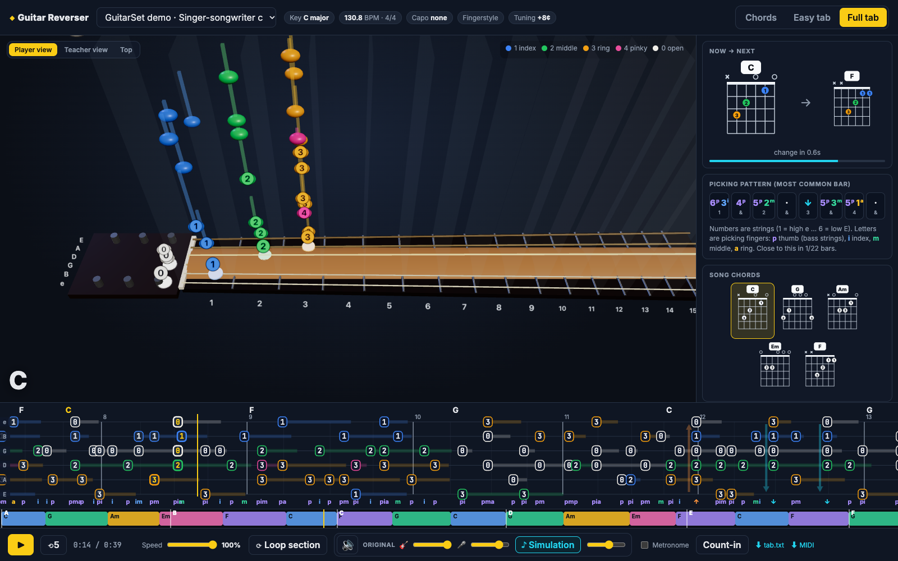
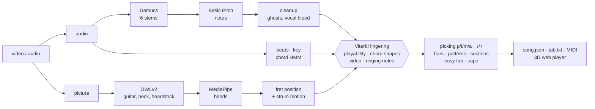
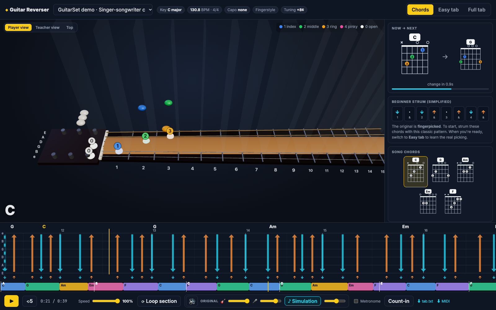
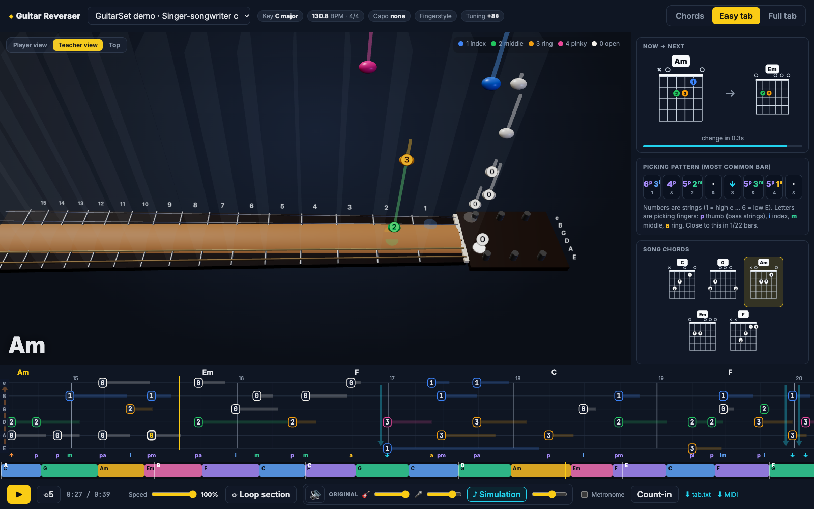
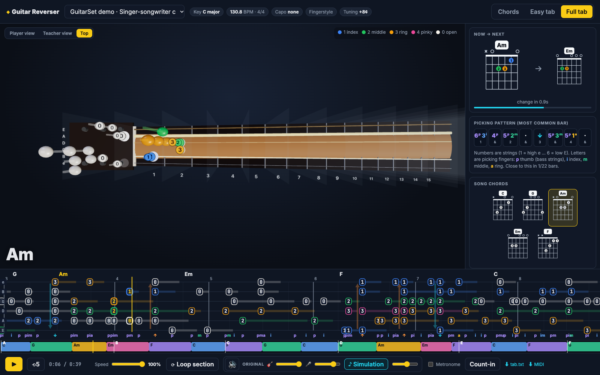

<div align="center">

# ◆ Guitar Reverser

**Turn a guitar video or song into a tab a beginner can actually play.**
Chords, string & fret for every note, fretting fingers, p/i/m/a picking or ↓/↑ strums,
replayed on a 3D fretboard synced to the original recording.



[How it works](#how-it-works) · [Quick start](#quick-start) · [The player](#the-player) · [Accuracy](#accuracy-measured-on-guitarset) · [Roadmap](#roadmap)

</div>

---

## Why

Audio-to-MIDI tools tell you *which* notes are played. A guitarist needs to know *where*:
the same E4 can be played in five places on the neck. They also need to know *how*:
which finger frets it, and whether it's strummed or plucked with the thumb. A beginner wants
the chord shapes and a strum pattern before the full transcription.

Guitar Reverser chains open-source models (stem separation, note transcription, object
detection, hand tracking) with guitar-specific music logic, and ends in a practice player.

| Problem | Usual tools | Guitar Reverser |
|---|---|---|
| Same note, up to 5 places on the neck | guess from audio | **global Viterbi fingering**: stretch, hand shifts (worse when fast), ringing notes, **open-chord shapes** (the classic 16-chord beginner chart is built in), plus a **video prior** from the fretting hand |
| Voice and other instruments | transcribe everything | **Demucs 6-stem separation**, then a vocal-bleed filter drops notes that copy the sung melody |
| Ghost notes and harmonics | kept | octave-ghost filter, plus a **robust decoder** that may drop a quiet note rather than force an impossible jump |
| Picking hand | ignored | **p/i/m/a** for fingerstyle; **↓/↑** from string onset order, wrist motion in the video, or "down on the beat" |
| Beginners | one dense tab | three levels: **Chords** (shapes + strum), **Easy tab** (bass + melody on the shapes), **Full tab** |
| Tuning off A440 | split notes | estimates the offset and cancels it by resampling before transcription |

## How it works



| Stage | Brick | What this project adds |
|---|---|---|
| Stems | [Demucs](https://github.com/facebookresearch/demucs) `htdemucs_6s` | guitar = guitar + bass + ½ other (acoustic low strings leak into "bass") |
| Notes | [Basic Pitch](https://github.com/spotify/basic-pitch) | tuning correction, merging, octave-ghost and vocal-bleed filters |
| Rhythm | [librosa](https://librosa.org) beat tracker, or [beat_this](https://github.com/CPJKU/beat_this) if installed | **metronome detection** (a click track is a ground-truth grid), meter and downbeat from accents, chord changes and bass onsets |
| Chords & key | — | beat-synchronous chroma from the note posteriorgram, bass weighting, key from note profile + draft chords, key prior, "no chord" state, Viterbi; maj, min, 7, maj7, m7, m7♭5 |
| Guitar in the picture | [OWLv2](https://huggingface.co/google/owlv2-base-patch16-ensemble) (open-vocabulary detection) | neck axis from body → fretting hand, nut from an aligned headstock |
| Hands | [MediaPipe Hand Landmarker](https://ai.google.dev/edge/mediapipe/solutions/vision/hand_landmarker) | fret from geometry (`−12·log2(1 − d/scale)`), picking-hand velocity |
| Fingering | — | Viterbi over (fingering, **hand position**) states with costs fitted on GuitarSet, drop states for ghost notes, then fretting and picking fingers |
| Player | [three.js](https://threejs.org), Vite, TypeScript | everything in `web/` |

## Quick start

Needs Python 3.10–3.12, Node 18+, `ffmpeg`. Tested on an M1 Mac (Demucs uses MPS, Basic Pitch uses CoreML).

```bash
uv venv --python 3.11 .venv
uv pip install --python .venv/bin/python -e .
npm --prefix web install
```

Optional, better beats and downbeats ([beat_this](https://github.com/CPJKU/beat_this), ISMIR 2024). The pipeline uses it automatically when it's installed:

```bash
uv pip install --python .venv/bin/python -e ".[beats]"
```

Try the player straight away. A CC-licensed demo song is bundled:

```bash
npm --prefix web run dev
```

Then open http://localhost:5173.

Analyse your own video or audio file:

```bash
.venv/bin/reverser analyze ~/Downloads/song.mp4 --title "My song"
```

| Option | Effect |
|---|---|
| `--no-video` | audio only (audio files like `.mp3`/`.wav` work too; you just don't get the video prior) |
| `--capo N` | force a capo position (default: chosen automatically) |
| `--force` | ignore caches and recompute everything |

A 4-minute video takes about 7 minutes the first time on an M1, most of it spent finding the guitar in the picture.
Re-runs take seconds: intermediate results are cached in `work/<slug>/`.
Models download on first use: Demucs, OWLv2 (Hugging Face) and the MediaPipe hand model (into `models/`).

**Outputs** go to `web/public/songs/<slug>/`:

- `song.json`: everything the player needs;
- `tab.txt`: ASCII tab;
- `transcription.mid`;
- a 720p web video;
- `guitar` and `backing` stems.

Analysed songs stay on your machine: `web/public/songs/` and `work/` are git-ignored.

## The player

<table>
<tr>
<td width="50%"><br><b>Chords</b>: the shape to hold, the next one falling in, and a beginner strum. For fingerpicked songs the strum is simplified, and the player says so.</td>
<td width="50%"><br><b>Easy tab</b>: bass + melody on the chord shapes, shown here in the <i>teacher</i> (mirror) view.</td>
</tr>
<tr>
<td><br><b>Top view</b> with ringing strings, finger colours and p/i/m/a under the tab.</td>
<td valign="top">

- **3D fretboard**: notes fall onto the exact string and fret, coloured by finger (1 index · 2 middle · 3 ring · 4 pinky · open). Ringing strings glow and vibrate. Drag to orbit.
- **Tab lane** under a fixed playhead: chord names, bar numbers, sustains, p/i/m/a or ↓/↑. Click or drag to seek; Ctrl+wheel zooms.
- **Practice**: speed 40–100 % with pitch preserved, loop a section, count-in, metronome on the detected beats.
- **Sound**: the simulation plays the notes you see falling (guitar-like synth, on by default, `S` to toggle). The original recording plays as two stems, *guitar* and *voice & rest*, each with its own volume: mute the guitar and play along. 🔊 / `M` mutes everything. Settings are remembered.
- **Video** with the hand-tracking overlay (fretting hand, picking hand, estimated fret).
- **Deep links**: `?song=demo&mode=full&t=14&view=top`.
- **Keys**: `space` play · `←/→` ±5 s · `L` loop · `M` mute · `S` simulation sound · `1/2/3` modes · `-/+` speed.

</td>
</tr>
</table>

## Accuracy, measured on GuitarSet

[GuitarSet](https://guitarset.weebly.com) is the reference dataset for guitar tablature. It has 360 excerpts (3 hours) of solo acoustic guitar:

- 6 players × 5 styles, each played as accompaniment (*comp*) and as a solo;
- recorded with a hexaphonic pickup, so every note has its true string and fret.

`reverser bench` runs the same code as `reverser analyze` on the microphone recordings and scores every stage with [mir_eval](https://github.com/craffel/mir_eval).

| Stage | Score | First version |
|---|---|---|
| Notes (onset ±50 ms, exact pitch) | **F1 78.9** (P 82.3 · R 75.7) | 64.2 |
| **Tab**: onset + pitch + **string** all right | **F1 50.4** (P 52.6 · R 48.4) | 39.9 |
| String chosen correctly, on correctly transcribed notes | **64.0 %** (lowest-fret baseline 42.3 %) | 62.1 % |
| Chords on accompaniments: root / major-minor / sevenths | 79.8 / **78.1** / 67.5 % | 79.2 / 77.9 / 66.6 % |
| Key (mir_eval weighted score) | **79.6 %** | 67.6 % |
| Beats F / downbeats F | 48.8 / 26.4 % | same |
| Tempo within 4 % (octave errors allowed) | 58.6 % (69.2 %) | same |

**The fingering stage alone**, fed the true notes (string accuracy):

| Method | Comp | Solo | All |
|---|---|---|---|
| Lowest fret (classic baseline) | 50.7 % | 31.0 % | 45.4 % |
| First version (low-position bias, one position per note) | 78.6 % | 44.1 % | 69.3 % |
| **Hand-position model, fitted costs (shipped)** | **83.3 %** | **58.2 %** | **76.5 %** |
| Same, with the true chords (upper bound) | 85.1 % | 59.8 % | 78.3 % |

### How accuracy was improved

Each change was tuned on players 00–02 and kept only if it also improved players 03–05, whom the tuning never saw.

| Method | Unseen players | Status |
|---|---|---|
| Re-plucked notes no longer merged into the previous note | tab F1 39.9 → 47.8 | ✅ bug fix |
| Basic Pitch thresholds (onset 0.55, frame 0.42, no Melodia) | note F1 72.4 → 79.0 | ✅ |
| **Hand-position model** (index-finger fret as a Viterbi state; a phrase stays in one box) + costs fitted by coordinate search | fingering 67.2 → 76.0 %, solos 45 → 60 % | ✅ |
| Key from the note profile (√-compressed Krumhansl) + draft chords instead of chords alone | key 68.2 → 76.8 % | ✅ |
| Half-diminished chords (m7♭5) | neutral on GuitarSet; needed for minor-key songs | ✅ |
| Video fret prior converted to capo-relative frets | bug: was off by the capo with a capo | ✅ bug fix |
| Metronome / click-track detection | exact grid when a click is present | ✅ |
| librosa beat-tracking variants (tempo priors, Basic Pitch onset envelope) | no gain | ❌ → optional beat_this |
| OWLv2 capo detection in the picture | unreliable boxes | ❌ |
| "No note below the capo" as capo evidence | breaks songs with an intro played without capo | ❌ |

What this says:

- **Beginner material works best.** On open-chord songs (singer-songwriter, rock and funk comps), the fingering gets 84–89 % of strings right from the notes.
- **Fitting the costs removed the "stay low on the neck" bias.** Real players don't fret low by default; a beginner version is what *Easy tab* is for.
- **Auto capo costs about 9 points on GuitarSet.** It picks a capo for 81 % of excerpts that have none, because a capo makes jazz keys (E♭, A♭…) look like open shapes. With capo 0 forced, string accuracy is 73.3 %. It is kept because it finds real capos, like capo 3 on the lesson video below; `--capo 0` turns it off.
- **Rhythm is now the weakest stage:** tempo is right in 59 % of excerpts. Install `beat-this`, or record with a metronome.
- **Caveat:** Basic Pitch saw GuitarSet in training, so the note scores are optimistic. The fingering and key changes do not depend on that.

### Real videos

A fingerstyle lesson whose human-written tab scrolls on screen gives a check outside GuitarSet:

| | Tab in the video | Guitar Reverser |
|---|---|---|
| Capo | 3 (intro without) | **3** |
| Tempo / meter | ♩ = 116, 3/4 | **114.8, 3/4** |
| Key | C minor | **C minor** (first version: C major) |
| Chord shapes | Am, Dm, Dm6/F, Bm7♭5, E, E7, A7 | **Am, Dm, Bm7♭5, E, E7**, F, A7 (first version: A, E, D, Bm7) |

<details>
<summary>Reproduce (≈ 700 MB download, 5 min on an M1)</summary>

```bash
mkdir -p work/guitarset && cd work/guitarset
curl -L -o annotation.zip "https://zenodo.org/api/records/3371780/files/annotation.zip/content"
curl -L -o audio_mono-mic.zip "https://zenodo.org/api/records/3371780/files/audio_mono-mic.zip/content"
unzip -q annotation.zip -d annotation && unzip -q audio_mono-mic.zip -d audio && cd ../..
.venv/bin/reverser bench            # --limit 30 for a quick subset, --players 00,01
```

Per-track rows (style, comp/solo, every metric) are written to `work/guitarset/results.json`.
</details>

## Project layout

```
reverser/         Python analysis package
  audio.py        stems → tuning → Basic Pitch → cleanup → beats → chords (HMM) → key
  vision.py       OWLv2 guitar parts → MediaPipe hands → fret position → picking-hand motion
  fingering.py    events → Viterbi string/fret/finger → strum vs pluck, p/i/m/a, ↓/↑
  arrange.py      quantisation, bars, patterns, sections, easy tab, chord-sheet strums
  theory.py       tuning, chord vocabulary, open/barre voicings, capo suggestion, key profiles
  pipeline.py     end-to-end orchestration + caching
  bench.py        GuitarSet benchmark
  cli.py          `reverser analyze` · `reverser bench`
web/              Vite + TypeScript + three.js player (demo song in web/public/demo)
tests/            fast unit tests: .venv/bin/python -m pytest tests
docs/screens/     README screenshots
```

## Roadmap

- **Beat tracking**: benchmark beat_this as the default (optional today).
- **Capo per section**: a song can switch capo (intro without, verses with), and a capo confidence would avoid false capos.
- Learn the fingering costs per style, or with a small model trained on GuitarSet + SynthTab.
- Swap Basic Pitch for a guitar-specific transcriber (fine-tuned on GuitarSet/SynthTab) once one with open weights exists.
- Per-note video evidence: fingertips against detected strings and frets, not just hand position.
- Techniques: hammer-on, pull-off, slide, bend, palm mute.
- Guitar Pro / MusicXML export and a microphone "wait for me" practice mode.

## Credits & licences

- **Bricks:**
  - Demucs (MIT), Basic Pitch (Apache-2.0), librosa (ISC);
  - MediaPipe (Apache-2.0), OWLv2 / transformers (Apache-2.0);
  - three.js (MIT), mir_eval (MIT).
- **Demo song and benchmark:** [GuitarSet](https://guitarset.weebly.com) by Xi, Bittner, Pauwels, Ye and Bello (ISMIR 2018), CC BY 4.0. See [`web/public/demo/ATTRIBUTION.md`](web/public/demo/ATTRIBUTION.md).
